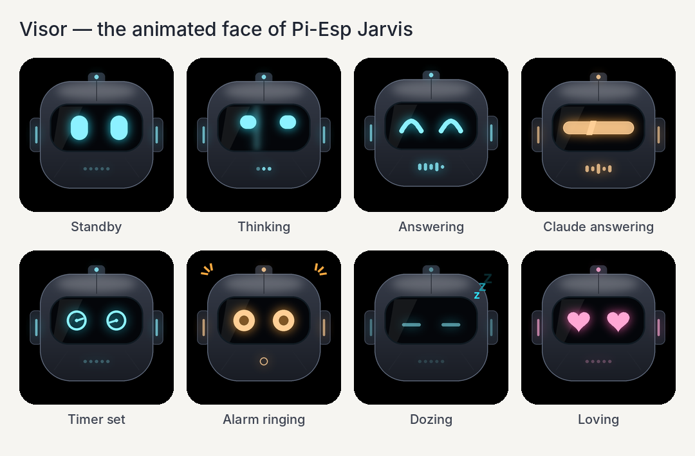
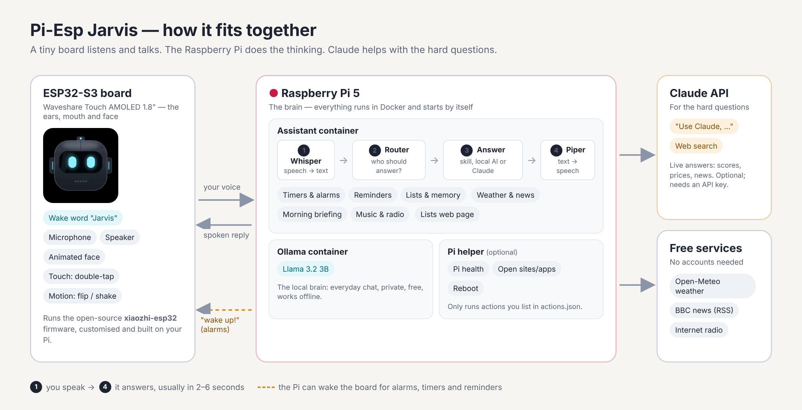

# Pi-Esp Jarvis

**Your own voice assistant: a Raspberry Pi 5, a little ESP32 screen, and Claude.**

<p align="center"></p>

Say **"Jarvis"** to the small round-cornered screen on your desk and ask it something. Your Raspberry Pi works out the
answer and the board speaks it back, while an animated robot face called *Visor* shows what it's doing.

* 🧠 **Private by default.** Everyday questions are answered by an AI model running *on your Pi* (Llama 3.2 3B).
* ✨ **Claude when you need it.** Say *"Use Claude, …"* for hard questions, or ask anything live ("who won last night?"). Claude searches the web.
* ⏰ **Timers, alarms and reminders** that wake the board up and ring.
* 🌦️ **Weather, news and a morning briefing.** Say "good morning" and hear your day in 30 seconds.
* 📝 **Lists and memory.** "Add milk to the shopping list", "remember the spare key is under the blue pot". Plus a page for your phone.
* 🎵 **Music.** Your own files, or thousands of internet radio stations by genre or name.
* 🍓 **Pi control.** "How's the Pi doing?", "open YouTube on the TV", "reboot the Pi".
* 📷 **Eyes (optional).** Plug a USB webcam into the Pi and ask "what do you see?". A pan/tilt webcam can even "look left" or "look at the door".
* 👋 **Gestures.** Double-tap the screen to talk, turn it face-down to snooze, shake it to stop.
* 🎲 **Dice and countdowns.** "Roll two dice" tumbles them on screen (shake to roll again); every timer shows a live countdown ring.
* 🔄 **Always upright.** Stand the board upside down and the screen turns round to match.

No coding needed to build it: two scripts do the work. Built with [Claude Code](https://claude.com/claude-code).

---

## What you need

| Part | Notes |
|---|---|
| **Raspberry Pi 5**, 8 GB | A 4 GB Pi works too; the setup script picks a smaller local AI model for it |
| microSD card (32 GB+) or an SSD | An SSD makes model loading quicker |
| Official Pi 5 power supply (27 W) | Weak power supplies cause slowdowns |
| **Waveshare ESP32-S3-Touch-AMOLED-1.8** | Revision 1 or 2 both work (V2 says "V2" on the board or box) |
| A USB-C **data** cable | Some cables only charge; you need one that carries data |
| *Optional:* a USB webcam | For "what do you see?". A pan/tilt one (e.g. Logitech QuickCam Orbit/Sphere) can also turn on command |
| *Optional:* a Claude API key | From [console.anthropic.com](https://console.anthropic.com/). Without one, everything runs locally |

Time: about 1 hour, mostly waiting for downloads and the firmware build.

## How it works

<p align="center"></p>

1. **The board** listens for the wake word "Jarvis" on its own chip. When it hears it, it streams your voice to the Pi over Wi-Fi.
2. **Whisper** on the Pi turns your speech into text.
3. **The router** decides who answers:
   * a **skill** for things like timers, lists, weather, music and Pi control (instant, no AI needed),
   * the **local AI** (Llama on the Pi) for everyday chat,
   * or **Claude** when you say "use Claude" or ask about something live.
4. **Piper** turns the answer into speech, and the board plays it while Visor changes expression.

The board runs the open-source [xiaozhi-esp32](https://github.com/78/xiaozhi-esp32) firmware. This project points it at your
Pi instead of the vendor's cloud, adds the Visor face and black screen, and adds double-tap, gestures and alarm wake-up.

---

## Build it

### Step 1 · Prepare the Pi

1. Use [Raspberry Pi Imager](https://www.raspberrypi.com/software/) to install **Raspberry Pi OS (64-bit)**.
   In the Imager's settings, choose a hostname (for example `jarvis`), turn on SSH, and enter your Wi-Fi details.
2. Boot the Pi, then open a terminal on it (or connect with `ssh you@jarvis.local`).

### Step 2 · Install Pi-Esp Jarvis on the Pi

```bash
git clone https://github.com/nativebreed/pi-esp-jarvis.git
cd pi-esp-jarvis
bash setup.sh
```

The script installs Docker if needed and asks three questions, all optional: your Claude API key, your town (for the
weather) and your units. Then it builds and starts everything. It also asks whether Jarvis may control the Pi; answer **y** for the Pi health and reboot features.

The first start downloads about 2 GB of AI models in the background. To watch progress:

```bash
docker compose logs -f assistant
```

When you see **"Local model … ready"**, the Pi side is done. It starts by itself after every reboot.

### Step 3 · Flash the ESP32 board

Plug the board into the Pi with the USB-C data cable, then run:

```bash
bash flash-esp32.sh        # board revision 1
bash flash-esp32.sh v2     # board revision 2
```

The first time, this builds the firmware on your Pi (about 20–30 minutes), then flashes it. Later runs are quick.
Not sure which revision you have? Try v1; if the screen stays black, run it again with `v2`.

### Step 4 · Connect the board to your Wi-Fi

1. The board creates a Wi-Fi network called **Xiaozhi-XXXX**. Join it from your phone.
2. A setup page opens (if not, go to `http://192.168.4.1`). Choose your **2.4 GHz** Wi-Fi and enter its password.
3. The board restarts and shows Visor on a black screen.

### Step 5 · Say "Jarvis"

Try: *"Jarvis… what's the weather tomorrow?"*, *"Set a timer for 5 minutes"*, *"Play some jazz"*, or *"Use Claude, explain black holes simply"*.

---

## Things to say

### Everyday

| You say | What happens |
|---|---|
| "What's the time?" / "Tell me a joke" | The local AI answers |
| "Use Claude, why is the sky blue?" / "Ask Claude to plan a weekend in Rome" | Claude answers |
| "Use Claude." → "Sure, what should I ask Claude?" → your question | Claude answers |
| "Who won the game last night?" / "What's the price of gold?" | Claude searches the web (if you added a key) |
| "Goodbye" / "That's all" | Ends the conversation; it also sleeps after 10 seconds of silence |

### Timers, alarms and reminders

| You say | What happens |
|---|---|
| "Set a timer for 10 minutes" / "Set a pasta timer for 9 minutes" | Starts a (named) timer |
| "How long is left on the timer?" / "Cancel the pasta timer" | Checks or cancels it |
| "Wake me up at 7" / "Set an alarm for 6:30 every weekday" | One-off or repeating alarm (wake-up alarms default to AM) |
| "What alarms do I have?" / "Turn off my 7 AM alarm" | Lists or cancels alarms |
| "Remind me to call Mum at 6" / "Remind me in 20 minutes to check the oven" | Sets a reminder |

While a timer runs, the screen shows a **countdown ring** that drains as time passes and turns amber in the last minute
(egg timers get a little egg). It keeps counting even after Jarvis goes quiet.

| You say | What happens |
|---|---|
| "Boil an egg" / "Soft-boiled egg timer" | 6-minute egg timer |
| "Hard-boiled egg" / "Medium-boiled egg" / "Jammy egg" | 10, 8 or 7 minutes |
| "Egg timer for 4 minutes" | Your own time |

When something is due, the board **wakes up by itself**, chimes and says what it's for.
To stop it, double-tap the screen (or say "Jarvis"), then say **"stop"** or **"snooze"**. You can also turn it face-down to snooze, or shake it to stop.
Stopping a morning alarm with "stop" plays your morning briefing.

### Weather, news and briefing

| You say | What happens |
|---|---|
| "What's the weather like?" / "…tomorrow?" / "…in Paris?" | A spoken forecast |
| "Do I need an umbrella?" | The local AI answers using the forecast |
| "What's the news?" | Top headlines (BBC News by default; change `NEWS_FEEDS`) |
| "Good morning" / "Brief me" | Date, weather, today's reminders, your lists and three headlines |

### Lists and memory

| You say | What happens |
|---|---|
| "Add milk, eggs and bread to the shopping list" | Adds to any list (new lists are created as you name them) |
| "What's on my shopping list?" / "Remove eggs from the shopping list" | Reads or edits a list |
| "Remember that the spare key is under the blue pot" | Saved; later, "where's the spare key?" just works |
| "What do you remember?" / "Forget about the spare key" | Reviews or removes saved facts |

**On your phone:** open `http://<your-pi-name>.local:8000/lists` (for example `http://jarvis.local:8000/lists`) on your home Wi-Fi.

### Music

| You say | What happens |
|---|---|
| "Play soul music" / "Play some jazz" | Songs from your `music` folder, or a popular radio station for that genre |
| "Play BBC Radio 2" / "Play classic rock radio" | Goes straight to internet radio |
| "Turn it up" / "Volume 40" / "Next" / "Resume" / "Stop" | Controls playback (say "Jarvis" or double-tap first) |

Put your own music files (mp3, flac, m4a, ogg) in the `music` folder; subfolders are fine.

### Changing Wi-Fi

Taking Jarvis somewhere new? Open `http://<your-pi-name>.local:8000/wifi` (e.g. `http://jarvis.local:8000/wifi`) on any
computer or phone, type the network name and password, and press **Save for Jarvis**. Next time you talk to Jarvis it
saves the network next to its current one, and connects to whichever is in range. Do this *before* you move: the board
can only collect it while it can still reach the Pi. The password stays on the Pi only until Jarvis has it.

| You say | What happens |
|---|---|
| "Change Wi-Fi" / "Connect to a new network" | Saves anything waiting on the Wi-Fi page; otherwise offers to go into Wi-Fi setup |

Already somewhere without the old network? The board opens its setup hotspot (**Xiaozhi-XXXX**) by itself; join it from a
phone or laptop and go to `http://192.168.4.1`. Pressing **BOOT** while it starts up does the same. Remember the Pi must be
on the same network as the board.

### Pi control (if you said yes to the helper)

| You say | What happens |
|---|---|
| "How's the Pi doing?" | Temperature, memory, disk, container health and uptime |
| "Open YouTube" / "Open BBC News" / "Close the browser" | Opens or closes things on a screen connected to the Pi |
| "Turn off the screen" | Monitor power |
| "Reboot the Pi" / "Shut down the Pi" / "Update the Pi" | Asks "Are you sure?" first |

Everything Jarvis can do on the Pi is listed in [`pi-helper/actions.json`](pi-helper/actions.json). Edit it to add your own apps, websites or scripts.

### Camera (if you plugged in a USB webcam)

`setup.sh` spots a USB webcam and asks whether Jarvis may use it. Describing the picture needs a Claude API key.

| You say | What happens |
|---|---|
| "What do you see?" / "Can you see me?" / "What am I holding?" | Takes a photo, shows it on the screen, and Claude describes it |
| "Take a picture" | Shows the photo on the board's screen for 20 seconds |
| "Show me the camera" / "Live view" | A live view on the board's screen (about 5–10 pictures a second). "Look left" works while it's on; double-tap or say "stop" to close it |
| "Is anyone in the room?" / "Read this" / "How many fingers am I holding up?" | Any question about the picture |
| "Look left" / "Look up a bit" / "Turn the camera right 45 degrees" | Turns a pan/tilt camera |
| "Look left and tell me what you see" | Turns, then describes |
| "Look around" | Three photos from left to right, described as one room |
| "Remember this as the door", then later "Look at the door" | Saves where the camera points and goes back to it |
| "Centre the camera" / "Look straight ahead" | Back to the middle |

Jarvis only takes a photo when you ask, and only sends it to Claude when you ask it a question about it. Photos and the live view
go from the Pi to the board over your own Wi-Fi, never to the internet, and each one uses a secret link so other devices on your
network can't open the camera. The live view switches the camera off by itself a few seconds after the screen closes, and
after 5 minutes at most. The last photo is kept on the Pi (in the assistant's data volume) and replaced by the next one.

To add a camera later, plug it in and run `bash setup.sh` again, or add these two lines to `.env` and run `docker compose up -d`:

```
COMPOSE_FILE=docker-compose.yml:docker-compose.camera.yml
CAMERA_DEVICE=/dev/video0
```

### Dice

| You say | What happens |
|---|---|
| "Roll a dice" / "Roll two dice" | Neon dice tumble on the screen and Jarvis says the result |
| "Roll again" | Same number of dice again |
| *Shake the board* (while the dice are showing) | Rolls again, and the caption shows the result |
| "Done" / *double-tap* | Back to Visor (it also goes back by itself after 30 seconds) |

### Gestures

| Gesture | While ringing | While talking or playing | While idle |
|---|---|---|---|
| **Double-tap the screen** | Pauses so you can say "stop"/"snooze" | Interrupts | Starts listening |
| **Face-down** (held still about 1 second) | Snoozes an alarm, stops a timer | Goes quiet | – |
| **Shake** | Stops it | Goes quiet | Cancels running timers |

The board learns which way up its screen is the first time you tap it while it's lying flat.

**Always upright.** Stand the board on its other end and the picture (and touch) turns 180° after about a second, so Visor
is never upside down. Lying flat, it keeps whichever way it last was. A V2 board knows which way is up out of the box; a V1
board learns it the first time it stands still after flashing, so stand it the right way up then. If it ever gets it backwards, stand it the right way up and say
**"Jarvis, flip the screen"** (or "the screen is upside down"): it turns round and remembers.

---

## Settings

Everything lives in the `.env` file. After editing it, run `docker compose up -d`.

| Setting | Default | What it does |
|---|---|---|
| `ANTHROPIC_API_KEY` | – | Your Claude key; without it, "use Claude" falls back to the local AI |
| `CLAUDE_MODEL` | `claude-sonnet-5-5` | `claude-haiku-5-5` is faster and cheaper |
| `LOCAL_MODEL` | `llama3.2:3b` | Any [Ollama](https://ollama.com/library) model, e.g. `llama3.2:1b` (faster) |
| `WEATHER_LOCATION` | guessed | Your town, e.g. `London, GB` |
| `WEATHER_UNITS` | `metric` | `metric`, `uk` (°C and mph) or `imperial` |
| `PIPER_VOICE` | `en_US-lessac-medium` | Any [Piper voice](https://huggingface.co/rhasspy/piper-voices), e.g. `en_GB-alan-medium` |
| `SPEECH_SPEED` | `1.0` | `1.2` = 20% faster |
| `WHISPER_MODEL` | `base.en` | `tiny.en` is faster; `small.en` is more accurate |
| `NEWS_FEEDS` | BBC News | Comma-separated RSS feed addresses |
| `AUTO_WEB_SEARCH` | `true` | Send obviously live questions to Claude automatically |
| `BRIEFING_AFTER_ALARM` | `true` | Morning briefing when you stop a morning alarm |
| `DEFAULT_RADIO_GENRE` | `soul` | What "play music" plays if your music folder is empty |
| `IDLE_TIMEOUT_S` | `10` | Seconds of silence before the board goes back to sleep |
| `CAMERA_DEVICE` | – | Your webcam, e.g. `/dev/video0` (needs the `COMPOSE_FILE` line above) |
| `CAMERA_PAN_INVERT` | `false` | Set to `true` if "look left" turns the camera right |

**Firmware options** (put them before `bash flash-esp32.sh`):
`WAKE_WORD=hiesp` (say "Hi ESP" instead of "Jarvis"), `OTA_URL=http://192.168.1.50:8000/xiaozhi/ota/` (use the Pi's IP address), `REBUILD=1` (force a fresh build),
`FLIP_OFFSET=16,0` (only if the picture is off-centre when the screen turns upside down).

**Change the face:** the animations are GIFs in [`firmware/face/emoji/`](firmware/face/emoji), one per mood, 240 × 240 px.
Replace them with your own (same file names) or tweak [`character.py`](firmware/face/character.py), then run the flash script again.

## Costs

The Pi side is free to run (apart from electricity). Claude is pay-as-you-go: a short spoken answer usually costs around a cent
or less, and web searches add about $10 per 1,000 searches. See [Anthropic's pricing](https://www.anthropic.com/pricing) for current rates;
you can set a monthly spending limit in the Claude Console. Without an API key it costs nothing.

## Troubleshooting

* **The screen says it can't connect to the server.** The board couldn't find the Pi by name. Reflash using the Pi's IP address:
  `OTA_URL=http://$(hostname -I | cut -d' ' -f1):8000/xiaozhi/ota/ bash flash-esp32.sh`
  Or, without reflashing: press **BOOT** right after the screen turns on to reopen Wi-Fi setup, and enter that address under **Advanced → Custom OTA URL**.
* **It hears me but never answers.** Run `docker compose logs -f assistant`: you'll see what it heard and who answered.
* **The screen keeps flashing black and white after flashing (a restart loop).** A chip on the board can get stuck, and with a
  battery connected, unplugging USB isn't a full reset. Unplug the **battery** and USB, wait 10 seconds, and plug in USB only.
  The firmware retries stuck chips at startup and starts without touch rather than looping, but a true power-off clears it.
* **"No ESP32 found".** Use a data cable. If it still isn't found, unplug the board, hold **BOOT** while plugging it back in, and retry.
* **"Permission denied" with Docker.** Log out and back in (or reboot) after the first setup, so your user can use Docker.
* **Alarms don't wake the board.** The board must be on and on Wi-Fi. On battery it powers off after 5 minutes idle, so use USB power if you rely on alarms.
* **"I couldn't get a picture from the camera".** Check the camera works on the Pi with `fswebcam test.jpg` and that `CAMERA_DEVICE` points at it (`ls /dev/v4l/by-id/`). Only one program can use the camera at a time.
* **Visor is upside down when the board stands normally.** Say "Jarvis, flip the screen" with the board the right way up.
* **After the screen flips, the picture sits a little off-centre.** Some screens need a different offset when turned round.
  Reflash with e.g. `FLIP_OFFSET=16,0 bash flash-esp32.sh v2` (try `0,0`, `16,0` or `26,0` until it's centred).
* **The wake word rarely triggers.** Speak from about 1 m away, or rebuild with `WAKE_WORD=hiesp REBUILD=1 bash flash-esp32.sh`.

## What's in the box

```
setup.sh               one-command setup for the Pi
flash-esp32.sh         builds and flashes the board firmware (in Docker)
docker-compose.yml     the two containers: ollama (local AI) and assistant
docker-compose.camera.yml  optional: gives the assistant your USB webcam
.env.example           all settings (setup.sh copies this to .env)
assistant/             the Pi server (Python): speech, router, skills, Claude, music, lists page
pi-helper/             optional helper that lets Jarvis control the Pi (install.sh, actions.json)
firmware/              firmware builder: xiaozhi-esp32 (pinned) + our patches + the Visor face
music/                 put your own music here (optional)
docs/                  pictures for this README
```

## Credits and licences

Pi-Esp Jarvis is released under the [MIT licence](LICENSE). It stands on the shoulders of:

* [xiaozhi-esp32](https://github.com/78/xiaozhi-esp32): the board firmware (MIT)
* [Ollama](https://ollama.com) with Meta's [Llama 3.2](https://www.llama.com/llama3_2/) ([Llama 3.2 Community Licence](https://www.llama.com/llama3_2/license/))
* [faster-whisper](https://github.com/SYSTRAN/faster-whisper) (MIT) and [Piper](https://github.com/OHF-Voice/piper1-gpl) (GPL-3.0), installed when the container is built
* [Claude](https://www.anthropic.com/claude) by Anthropic
* [Open-Meteo](https://open-meteo.com/): weather data (CC BY 4.0)
* [radio-browser.info](https://www.radio-browser.info): the community radio directory

The Visor character is original artwork made for this project.

*Pi-Esp Jarvis is a hobby project. It isn't affiliated with Anthropic, Raspberry Pi, Espressif or Waveshare.*
